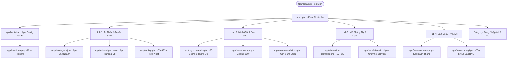
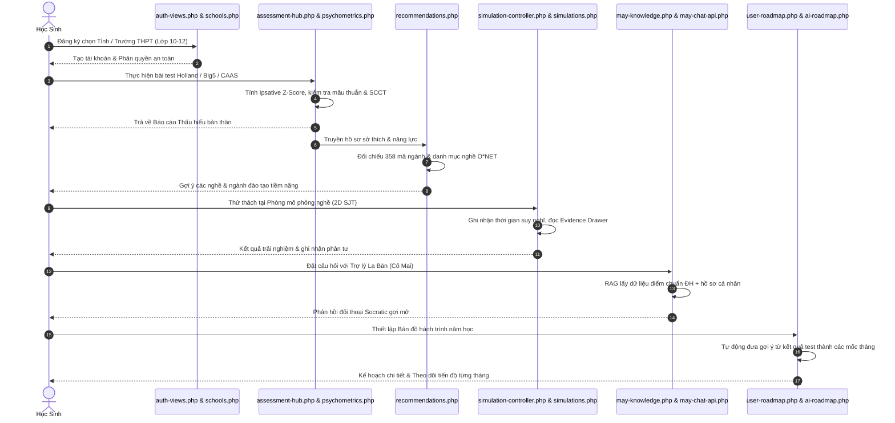

# BÁO CÁO TOÀN DIỆN HỆ THỐNG HUỚNG NGHIỆP 360 (JOBSIMU)
## Báo Cáo Thực Trạng Toàn Diện Mã Nguồn, Kiến Trúc Dữ Liệu, Logic Vận Hành & Lộ Trình Nâng Cấp Hệ Thống
*Cập nhật thời điểm: Tháng 11/2026 — Phiên bản hệ thống: v3.0 (Psychometric & Evidence-Centered Architecture)*

---

## MỤC LỤC TỔNG QUAN

1. [Tổng Quan Tiến Trình Phát Triển (Development Journey)](#1-tổng-quan-tiến-trình-phát-triển)
2. [Bản Đồ Kiến Trúc & Chi Tiết Từng File Trong Dự Án](#2-bản-đồ-kiến-trúc--chi-tiết-từng-file-trong-dự-án)
   - 2.1. Tầng Hạ Tầng & Điều Hướng Cốt Lõi (Core & Infrastructure)
   - 2.2. Trụ Cột 1: Khám Phá Tri Thức & Tuyển Sinh (Knowledge & Admissions Hub)
   - 2.3. Trụ Cột 2: Thấu Hiểu Bản Thân & Tâm Trắc Học (Assessment & Psychometrics Hub)
   - 2.4. Trụ Cột 3: Trải Nghiệm Mô Phỏng Nghề (Simulation Hub: 2D SJT & 3D Unity)
   - 2.5. Trụ Cột 4: Lập Kế Hoạch, Bản Đồ Hành Trình & Trợ Lý La Bàn AI (Roadmap & AI Companion)
   - 2.6. Phân Hệ Người Dùng, Trường Học & Đăng Ký Chuẩn Hóa
   - 2.7. Cơ Sở Dữ Liệu & Các Bản Migration
   - 2.8. Hệ Thống Kiểm Thử (Automated Test Suites)
3. [Mối Liên Kết Dữ Liệu & Luồng Nghiệp Vụ Giữa Các File (Data Flow & Interconnection)](#3-mối-liên-kết-dữ-liệu--luồng-nghiệp-vụ-giữa-các-file)
4. [Bản Chất Các Khối Logic Cốt Lõi Của Hệ Thống](#4-bản-chất-các-khối-logic-cốt-lõi-của-hệ-thống)
   - 4.1. Logic Tâm Trắc Học & Xử Lý Điểm Số (Computational Psychometrics)
   - 4.2. Logic Mô Phỏng Nghề Nghiệp (2D SJT & 3D Vertical Slice)
   - 4.3. Logic Trợ Lý Hướng Nghiệp Thông Minh (Trợ Lý La Bàn / Cô Mai)
   - 4.4. Logic Bản Đồ Hành Trình & Quản Trị Mục Tiêu (User Roadmap)
5. [Đánh Giá Chất Lượng Mã Nguồn & Độ Tối Ưu Hóa (Code Quality & Optimization Review)](#5-đánh-giá-chất-lượng-mã-nguồn--độ-tối-ưu-hóa)
   - 5.1. Những điểm đã làm tốt & Tối ưu xuất sắc
   - 5.2. Các điểm nghẽn kỹ thuật & Điểm cần tái cấu trúc (Technical Debt)
6. [Thực Trạng Cơ Sở Dữ Liệu (Database & Data Assets)](#6-thực-trạng-cơ-sở-dữ-liệu)
   - 6.1. Dữ liệu đã nâng cấp thành công
   - 6.2. Dữ liệu đang trong quá trình chuyển giao & Cần lưu ý
7. [Toàn Cảnh Nâng Cấp: Đã Làm, Đang Làm & Sẽ Tiếp Tục Làm (Past, Present & Future Roadmap)](#7-toàn-cảnh-nâng-cấp-đã-làm-đang-làm--sẽ-tiếp-tục-làm)

---

## 1. TỔNG QUAN TIẾN TRÌNH PHÁT TRIỂN

Hệ thống **Hướng Nghiệp 360 (JobSimu)** khởi đầu là một nền tảng web hướng nghiệp thử nghiệm cơ bản chạy trên nền tảng PHP Legacy, cung cấp bài trắc nghiệm sở thích nghề nghiệp Holland (RIASEC) đơn giản và các kịch bản đọc tình huống nghề nghiệp văn bản.

Trải qua các giai đoạn cải tiến liên tục, hệ thống đã chuyển mình thành một **Nền tảng Hướng Nghiệp Thực Chứng Toàn Diện (Evidence-Centered Career Guidance Platform)** với các mốc tiến trình quan trọng:

```
[Khởi nguyên: PHP Legacy] 
         │
         ▼
[Mốc v2.0 - 2.2: Tái Cấu Trúc 4 Trụ Cột (Four Hubs)]
   ├── Hub 1: Tri Thức (Knowledge Hub)
   ├── Hub 2: Bản Thân (Assessment Hub)
   ├── Hub 3: Mô Phỏng (Simulation Hub 2D & Babylon.js 3D)
   └── Hub 4: Hành Trình (AI Roadmap Hub)
         │
         ▼
[Mốc v3.0: Chuẩn Hóa Tâm Trắc Học & Tuyển Sinh Thực Chứng]
   ├── Thuật toán Ipsative Within-Person Z-Score & 4 Góc SCCT
   ├── Tích hợp 358 Mã ngành Đào tạo cấp IV chuẩn Bộ GD&ĐT (HNV)
   ├── Cơ sở dữ liệu 235 trường ĐH/CĐ, điểm chuẩn 3 năm, học phí, đề án
   └── Trợ lý La Bàn (Cô Mai) chạy trên kiến trúc RAG tra cứu tri thức
         │
         ▼
[Hiện tại: Nâng Cấp Giao Diện, Phân Vùng Thí Sinh & Bản Đồ Hành Trình]
   ├── Tái thiết kế toàn diện UI/UX theo Design Tokens hiện đại
   ├── Quy hoạch đăng ký theo Tỉnh (Lào Cai, Hà Giang, Hưng Yên) & 6 trường THPT
   ├── Bản đồ hành trình cá nhân hóa theo tháng (Monthly Execution Planner)
   └── Dự án Unity 6 URP (JobSimu3D - Vertical Slice Tiết Học Lớp 8A)
```

---

## 2. BẢN ĐỒ KIẾN TRÚC & CHI TIẾT TỪNG FILE TRONG DỰ ÁN

Hiện tại, codebase bao gồm hơn **21.400 dòng mã PHP**, kèm theo dự án **Unity 6 URP (`JobSimu3D/`)**, bản chuyển tiếp **Babylon.js WebGL (`game/`)**, cùng **49 bảng cơ sở dữ liệu** và hệ thống kiểm thử tự động toàn diện.



---

### 2.1. Tầng Hạ Tầng & Điều Hướng Cốt Lõi (Core & Infrastructure)

| Tập tin | Số dòng | Nhiệm vụ chính & Trách nhiệm kỹ thuật |
| :--- | :---: | :--- |
| `index.php` | 47 | **Bộ điều phối trung tâm (Front Controller)**: Nhận mọi request qua tham số `?page=...`, kiểm tra quyền hạn, CSRF token, khởi tạo bảo vệ giao dịch, định tuyến đến view hoặc API tương ứng. Chứa trực tiếp mã nguồn của trang Holland Assessment, Result và User Dashboard. |
| `app/bootstrap.php` | 94 | **Khởi tạo hệ thống**: Tự động parse file `.env` thuần PHP, nạp cấu hình `config.php`, thiết lập múi giờ `Asia/Ho_Chi_Minh`, session cookie an toàn (Lax, HttpOnly), tạo kết nối PDO MySQL/SQLite và **tự động gọi chuỗi migration** cập nhật schema CSDL. |
| `app/functions.php` | 965 | **Thư viện hàm cốt lõi**: Chứa hàm truy vấn CSDL (`db()`), bảo mật session (`user()`, `require_login()`), chống CSRF (`csrf_field()`, `verify_csrf()`), mã hóa mật khẩu, hàm tính toán điểm Holland RIASEC, audit logs, format hiển thị và hàm chạy migration lõi (`run_migrations()`). |
| `health.php` | ~100 | **Health Check & Telemetry**: Kiểm tra tình trạng kết nối CSDL, sự tồn tại của các bảng dữ liệu trọng yếu, phiên bản PHP, dung lượng bộ nhớ, dùng cho giám sát uptime hệ thống. |
| `admin.php` | ~500 | **Trang quản trị tập trung**: Dashboard dành riêng cho tài khoản role `admin` để quản lý người dùng, xem thống kê bài đánh giá, kiểm duyệt bài viết và cấu hình hệ thống. |
| `app/header.php` | 418 | **Thanh điều hướng chung (Universal Header)**: Định nghĩa thanh điều hướng 4 Trụ cột chuẩn hóa, breadcrumbs, hiển thị thông tin học sinh, menu di động responsive và kết nối tài nguyên CSS/JS. |
| `app/footer.php` | 1 | **Chân trang dùng chung**: Đóng cấu trúc HTML, hiển thị thông tin bản quyền và lưu ý bảo mật. |
| `app/home-hubs.php` | 325 | **Trang chủ 4 Trụ Cột**: Giới thiệu bức tranh toàn cảnh của hệ thống Hướng Nghiệp 360, các khối dẫn nhập trực quan thúc đẩy học sinh bắt đầu từ khám phá sở thích đến lập kế hoạch. |

---

### 2.2. Trụ Cột 1: Khám Phá Tri Thức & Tuyển Sinh (Knowledge & Admissions Hub)

| Tập tin | Số dòng | Nhiệm vụ chính & Trách nhiệm kỹ thuật |
| :--- | :---: | :--- |
| `app/knowledge-hub.php` | 433 | **Hub Tri Thức Nghề**: Thư viện bài viết hướng nghiệp, phân loại theo nhóm ngành nghề và mã Holland RIASEC, tìm kiếm bài viết, hỗ trợ biên tập nội dung. |
| `app/training-majors.php` | 1.005 | **Quản lý 358 Mã Ngành Đào Tạo (Chuẩn Bộ GD&ĐT)**: Khởi tạo bảng `training_majors`, `major_fields`, `major_subgroups`, hỗ trợ tra cứu chi tiết mã ngành cấp IV, chương trình đào tạo, cơ hội nghề nghiệp và ánh xạ trường đào tạo. |
| `app/training-majors-importer.php` | 1.077 | **Công cụ nhập dữ liệu ngành**: Xử lý dữ liệu nguồn từ Hướng Nghiệp Việt (HNV), chuẩn hóa mã ngành 7 số (Đại học) và 6 số (Cao đẳng), khử trùng dữ liệu trước khi nạp vào CSDL. |
| `app/majors-explorer.php` | 552 | **Giao diện Tra Cứu Danh Mục Ngành**: Trực quan hóa 23 khối ngành lớn (Kỹ thuật, Y dược, Kinh doanh, Sư phạm,...) kèm bộ lọc theo hệ đào tạo, khối thi xét tuyển và từ khóa. |
| `app/majors-admin.php` | 1.071 | **Trang quản trị ngành học**: Dành cho admin duyệt các ánh xạ ngành-nghề, xử lý review queue và phát hiện sai sót dữ liệu tuyển sinh. |
| `app/university-explorer.php` | 690 | **Cổng Tra Cứu Trường Đại Học/Cao Đẳng**: Danh bạ hơn 235 cơ sở giáo dục đại học, phân loại theo miền (Bắc - Trung - Nam), loại hình (Công lập - Dân lập), hiển thị mức học phí ước tính và các chương trình đào tạo nổi bật. |
| `app/university-compare.php` | 363 | **Công Cụ So Sánh Trường ĐH**: So sánh trực tiếp 2 trường song song trên cùng một màn hình về: điểm chuẩn đầu vào, khung học phí, tổ hợp xét tuyển, cơ sở vật chất và môi trường rèn luyện. |
| `app/career-admissions.php` | 164 | **Cầu nối Nghề - Tuyển sinh**: Ánh xạ từ một nghề cụ thể (`careers`) sang các chương trình đào tạo (`programs`) và các trường đại học tuyển sinh ngành đó. |
| `app/admissions-p2.php` | 184 | **Tuyển Sinh P2**: Xử lý cấu trúc dữ liệu điểm chuẩn theo phương thức xét tuyển (Điểm thi tốt nghiệp THPT, ĐGNL, Học bạ). |
| `app/admissions-p22.php` | 71 | **Tuyển Sinh P2.2**: Khởi tạo bảng `tuition_records` và `institution_tuition_bands`, phân nhóm học phí theo năm và khối ngành. |
| `app/admissions-p22-notices.php` | 65 | **Đề án & Thông báo tuyển sinh**: Quản lý các đề án tuyển sinh chính thức được phát hành, lưu trữ đường dẫn tài liệu nguồn gốc có kiểm duyệt. |
| `app/admissions-admin.php` | 110 | **Quản trị tuyển sinh**: Thêm, sửa, duyệt các bản ghi điểm chuẩn và thông tin học phí. |
| `app/lookup.php` | 1.177 | **Trung tâm Tra cứu Tuyển sinh Hợp nhất (Lookup Hub)**: Trang tra cứu hiện đại tích hợp bộ lọc đa chiều (Khu vực, Điểm chuẩn, Khối thi, Ngành học) với tốc độ phản hồi tối ưu. |

---

### 2.3. Trụ Cột 2: Thấu Hiểu Bản Thân & Tâm Trắc Học (Assessment & Psychometrics Hub)

| Tập tin | Số dòng | Nhiệm vụ chính & Trách nhiệm kỹ thuật |
| :--- | :---: | :--- |
| `app/assessment-hub.php` | 509 | **Hub Đánh Giá Năng Lực**: Trung tâm tập hợp các bài trắc nghiệm chuẩn hóa: Holland (30 câu O\*NET), Big Five Mini-IPIP (20 câu), Năng lực thích ứng nghề CAAS (12 câu), MBTI (12 câu), Trí tuệ cảm xúc EQ (10 tình huống). Xuất **Báo cáo tổng hợp đa chiều (Assessment Report)**. |
| `app/psychometrics.php` | 334 | **Toán Học Tâm Trắc Học Thuần Túy**: Hiện thực thuật toán **Ipsative Within-Person Z-Score**, kiểm tra tính hợp lệ phản hồi (Flatline check), đối chiếu nghịch chiều chống thiên kiến đồng thuận, phân loại **4 góc phần tư SCCT (Social Cognitive Career Theory)**. |
| `app/soka-mirror.php` | 481 | **Gương Phản Chiếu 360° (SOKA Mirror)**: Cơ chế sinh token ẩn danh để học sinh gửi cho bạn bè, người thân hoặc thầy cô nhận xét khách quan. Đối chiếu giữa điểm Tự đánh giá (Self) và Quan sát bên ngoài (Others) theo ma trận Johari. |
| `app/constraints.php` | 142 | **Bảng Kiểm Tra Sự Đánh Đổi Thực Tế (Job Sacrifices)**: Đánh giá khả năng chấp nhận các rào cản thực tế của nghề (thời gian học dài 6-8 năm, kỷ luật thể lực khắt khe, áp lực cảm xúc, soi lỗi chi tiết). |
| `app/recommendations.php` | 154 | **Động Cơ Gợi Ý Nghề Nghiệp**: Tổng hợp trọng số giữa mã sở thích Holland, chỉ số tâm lý Big5/CAAS, điểm rào cản và lịch sử làm mô phỏng để xếp hạng danh sách nghề phù hợp. |
| `app/discover.php` | 547 | **Module Khám Phá Nhanh (5 câu)**: Công cụ trắc nghiệm rút gọn cho học sinh mới tiếp cận, định hướng nhanh 1-2 khối sở thích tiềm năng trước khi làm bài test chuyên sâu. |
| `app/compare.php` | 638 | **Module So Sánh Ưu Tiên (20 câu)**: Hỗ trợ học sinh phân vân giữa các hướng đi, cân đo các tiêu chí: sở thích, cơ hội việc làm, thu nhập kỳ vọng, vị trí địa lý và chi phí học tập. |

---

### 2.4. Trụ Cột 3: Trải Nghiệm Mô Phỏng Nghề (Simulation Hub: 2D SJT & 3D Unity)

| Tập tin / Thư mục | Quy mô | Nhiệm vụ chính & Trách nhiệm kỹ thuật |
| :--- | :---: | :--- |
| `app/simulation-hub.php` | 292 | **Hub Mô Phỏng Nghề**: Danh mục các phòng mô phỏng nghề nghiệp thực tế, theo dõi lịch sử trải nghiệm, cảm nhận cá nhân và chỉ số rèn luyện kỹ năng. |
| `app/simulations.php` | 165 | **Kho Kịch Bản Tình Huống 2D (SJT)**: Lưu trữ các tình huống giả định có xung đột lợi ích (trade-off) và **Evidence Drawer (Ngăn chứng cứ ẩn)**, yêu cầu học sinh mở đọc log kỹ thuật/hồ sơ bệnh án trước khi chọn cách giải quyết. |
| `app/simulation-controller.php` | 629 | **Bộ Điều Phối Mô Phỏng 2D**: Tiếp nhận lựa chọn của người chơi, ghi nhận thời gian suy ngẫm (dwell time), tính toán điểm năng lực (phân tích, quyết đoán, thấu cảm, cẩn trọng) và lưu phản tư vào bảng `simulation_attempts`. |
| `app/simulation-3d.php` | 16 | **Cổng Chuyển Tiếp WebGL**: Nhúng bản mô phỏng 3D WebGL (Babylon.js) vào iframe trang web nếu bản build `game/dist/index.html` tồn tại. |
| `api/game/` | ~300 | **Cổng API Game (Đang Khóa Fail-Closed 503)**: Trả về `503 GAME_SYNC_UNAVAILABLE` có chủ đích nhằm ngăn chặn gian lận điểm từ client khi chưa có cơ chế xác thực authoritative từ máy chủ. |
| `game/` | Dự án Web | **Bản Chuyển Tiếp Babylon.js**: 4 khu vực blockout trường học (Lớp học, Phòng hội đồng, Hành lang, Sân trường), dùng làm bản demo WebGL nhẹ. |
| `JobSimu3D/` | Dự án Unity 6 | **Bản Game 3D Chính Thống**: Vertical Slice **Một tiết Khoa học tự nhiên Lớp 8A (Trường THCS Bình Minh)**. Góc nhìn thứ nhất (First-person), URP, New Input System, vòng lặp 6 giai đoạn xác định (`ScenarioSession`), lưu trữ cục bộ trung thực (`LocalSaveStore`), tuân thủ chuẩn mực an toàn tâm lý học đường. |

---

### 2.5. Trụ Cột 4: Lập Kế Hoạch, Bản Đồ Hành Trình & Trợ Lý La Bàn AI (Roadmap & AI Companion)

| Tập tin | Số dòng | Nhiệm vụ chính & Trách nhiệm kỹ thuật |
| :--- | :---: | :--- |
| `app/ai-roadmap.php` | 1.811 | **Controller & View Bản Đồ Hành Trình**: Giao diện quy hoạch lộ trình 4 giai đoạn, chế độ xem theo tháng (Monthly View), lọc công việc, tạo mốc rèn luyện, tích hợp Trợ lý La Bàn AI và hỗ trợ xuất bản in A4. |
| `app/user-roadmap.php` | 1.571 | **Tầng Nghiệp Vụ Roadmap**: Quản trị dữ liệu bảng `user_roadmaps` và `user_roadmap_milestones`, sinh gợi ý mốc hành động tự động từ kết quả bài test tâm lý, quản lý trạng thái hoàn thành công việc. |
| `app/plan.php` | 1.016 | **Công Cụ Kế Hoạch Hành Động (Action Plan)**: Lập kế hoạch theo mốc tháng/năm, quản lý danh sách việc cần làm (`career_action_plans`, `career_action_plan_items`), tạo liên kết chia sẻ bảo mật qua token (`plan_share_tokens`). |
| `app/may-widget.php` | 68 | **Giao diện Bong Bóng Chat**: Widget trò chuyện nổi cố định ở góc dưới màn hình, tích hợp trên toàn bộ website, hỗ trợ mở nhanh các câu hỏi gợi ý. |
| `app/may-chat-api.php` | 199 | **API Xử Lý Chat**: Endpoint REST nhận câu hỏi từ học sinh, kiểm soát hạn mức (10 tin nhắn/ngày), ghi log hội thoại, gọi pipeline RAG và phản hồi JSON. |
| `app/may-knowledge.php` | 539 | **Module RAG (Retrieval-Augmented Generation)**: Truy xuất tri thức nội bộ có cấu trúc: 358 mã ngành, danh bạ trường đại học, dữ liệu điểm chuẩn, hồ sơ nghề O\*NET để cung cấp làm ngữ cảnh kiểm chứng (grounding context) cho AI. |
| `app/may-actions.php` | 253 | **Registry Hành Động Có Thẩm Định**: Đăng ký các Action ID do máy chủ quản lý (mở báo cáo, tra cứu điểm chuẩn, làm bài test), tuyệt đối không để AI tự ý phát minh đường dẫn sai. |
| `app/may-prompt.php` | 109 | **System Prompt Socratic**: Định hình phong cách của Trợ lý La Bàn: trung thực, đồng hành thấu cảm, không phán xét, không đưa ra lời khẳng định tuyệt đối, đặt câu hỏi gợi mở để học sinh tự suy nghĩ. |
| `app/may-telemetry.php` | 175 | **Đo lường & Giám sát Chatbot**: Thu thập chỉ số hiệu suất hội thoại, thời gian phản hồi, tỷ lệ câu hỏi rơi vào fallback để liên tục cải thiện chất lượng câu trả lời. |
| `app/chat-providers.php` | 246 | **Bộ Adapter Đa Nhà Cung Cấp AI**: Trừu tượng hóa kết nối đến Gemini API, OpenAI, Claude hoặc chế độ Local Mockup Fallback khi không có API key. |
| `app/admin-chatbot.php` | 318 | **Bảng Điều Khiển Chatbot**: Dành cho quản trị viên theo dõi lịch sử tương tác, tỷ lệ hài lòng, câu hỏi phổ biến và chi phí tiêu thụ token. |
| `app/career-conversations.php` | 69 | **Góc Người Trong Nghề**: 9 tình huống đối thoại thực tế của 3 nghề (Giáo viên, Lập trình viên, Thiết kế đồ họa) kèm câu hỏi phản tư. |

---

### 2.6. Phân Hệ Người Dùng, Trường Học & Đăng Ký Chuẩn Hóa

| Tập tin | Số dòng | Nhiệm vụ chính & Trách nhiệm kỹ thuật |
| :--- | :---: | :--- |
| `app/auth-views.php` | 572 | **Giao Diện Xác Thực & Hồ Sơ**: Xử lý view và logic Đăng ký, Đăng nhập, Quên mật khẩu, Chỉnh sửa hồ sơ cá nhân. Tích hợp dropdown Tỉnh - Trường thông minh. |
| `app/schools.php` | 705 | **Danh Mục Trường Học & Tỉnh Thành**: Quản lý bảng `provinces` và `schools`. Chứa API trả về danh mục trường theo tỉnh với cơ chế in-memory caching đạt tốc độ chuyển đổi tức thì **0ms**. Hiện tại chuẩn hóa 3 tỉnh (Lào Cai, Hà Giang, Hưng Yên) và 6 trường THPT trọng điểm. |
| `scripts/cleanup-grade-6-9-students.php` | ~500 | **Script Dọn Dẹp Học Sinh Lớp 6–9**: Công cụ bảo mật chuẩn giao dịch (Transactional Backup-First). Tự động tạo bản sao lưu JSON và SQL trước khi dọn dẹp các tài khoản học sinh THCS để tập trung tài nguyên vào đối tượng THPT Lớp 10–12 theo định hướng mới. |

---

### 2.7. Cơ Sở Dữ Liệu & Các Bản Migration

Cơ sở dữ liệu của dự án gồm **49 bảng**, được quản lý tiến hóa qua các tệp migration kế thừa trong `database/migrations/`:

| Bản Migration | Nội dung chính |
| :--- | :--- |
| `schema.sql` & `seed.sql` | Cấu trúc nền tảng ban đầu: `users`, `careers`, `questions`, `assessments`, `favorites`, `simulation_attempts`, `audit_logs`. |
| `2026_11_four_hubs_upgrade.sql` | Mở rộng 4 Hub: bảng `knowledge_articles`, `user_psychometrics`, `ai_logs`, `ai_chat_messages`. |
| `2026_11_game3d_init.sql` | Khởi tạo bảng lưu trữ phiên chơi 3D (hiện đang fail-closed chờ hoàn thiện máy chủ). |
| `2026_12_scientific_psychometrics_v3.sql` | Nâng cấp tâm trắc học v3.0: bảng `soka_mirror_requests`, `soka_mirror_responses`, cột `ipsative_z_scores`, `validity_metrics`. |
| `2026_13_training_majors_catalog.sql` | Nạp cấu trúc danh mục 358 mã ngành đào tạo cấp IV: `training_majors`, `major_fields`, `major_subgroups`, `training_major_mappings`. |
| `2026_14_user_custom_roadmap.sql` | Kiến trúc Bản đồ hành trình cá nhân: bảng `user_roadmaps`, `user_roadmap_milestones`. |
| `2026_15_provinces_and_schools.sql` | Danh mục chuẩn hóa Tỉnh/Thành phố và Trường học: bảng `provinces`, `schools`, bổ sung khóa ngoại vào `users`. |
| `2026_16_journey_and_admissions.sql` | Hành trình 4 bước mới: bảng `user_discovery_sessions`, `user_comparisons`, `career_action_plans`, `career_action_plan_items`, `plan_share_tokens`. |
| `2026_17_cleanup_grade_6_9_students.sql` | Dọn dẹp tài khoản học sinh Lớp 6–9 có ràng buộc khóa ngoại an toàn. |
| `2026_18_add_hung_yen_nguyen_du.sql` | Mở rộng địa bàn thí điểm: bổ sung Tỉnh Hưng Yên và Trường THPT Nguyễn Du. |

---

### 2.8. Hệ Thống Kiểm Thử (Automated Test Suites)

Hệ thống sở hữu bộ kiểm thử tự động phong phú trong `tests/` đảm bảo tính toàn vẹn khi nâng cấp:
- `tests/psychometrics-test.php`: Kiểm tra ngân hàng câu hỏi, đảo trục, công thức Z-score và loại trừ gian lận.
- `tests/four-hubs-data-test.php`: Kiểm tra tính toàn vẹn dữ liệu 4 Hub, phân lập tài khoản và hạn mức chat.
- `tests/training-majors-test.php`: Kiểm tra 358 mã ngành, cấu trúc cha-con (fields/subgroups) và liên kết nghề.
- `tests/user-roadmap-test.php`: Kiểm tra khởi tạo bản đồ, sinh gợi ý từ kết quả test, cập nhật tiến độ công việc.
- `tests/signup-schools-test.php`: Kiểm tra ràng buộc đăng ký theo tỉnh/trường và bảo toàn tài khoản cũ.
- `tests/preservation-regression-test.php`: Kiểm tra hồi quy bảo vệ toàn bộ cấu trúc cũ khi triển khai tính năng mới.
- `tests/journey-logic-test.php`: Kiểm tra logic 4 module hành trình (Discover, Lookup, Compare, Plan).
- `tests/soka-and-constraint-test.php`: Kiểm tra sinh token gương 360°, giới hạn IP và bảng kiểm tra đánh đổi.
- `tests/may-chat-test.php` & `tests/may-knowledge-test.php`: Kiểm tra RAG tri thức và kịch bản đối thoại của Trợ lý La Bàn.

---

## 3. MỐI LIÊN KẾT DỮ LIỆU & LUỒNG NGHIỆP VỤ GIỮA CÁC FILE

Mối liên kết giữa các file trong hệ thống không phải là tập hợp các trang rời rạc, mà tạo thành một **vòng lặp hướng nghiệp khép kín (Continuous Evidence Loop)**:



---

## 4. BẢN CHẤT CÁC KHỐI LOGIC CỐT LÕI CỦA HỆ THỐNG

### 4.1. Logic Tâm Trắc Học & Xử Lý Điểm Số (Computational Psychometrics)

1. **Chuẩn hóa nội tại cá nhân (Ipsative Within-Person Z-Score)**:
   - *Vấn đề*: Học sinh thường có xu hướng đánh toàn điểm 4 hoặc 5 cho mọi câu (Acquiescence Bias), làm mất đi tính phân hóa của kết quả.
   - *Giải pháp*: `app/psychometrics.php` tính giá trị trung bình cá nhân ($\mu_{user}$) và độ lệch chuẩn cá nhân ($\sigma_{user}$). Điểm Z của từng nhóm RIASEC được tính bằng:
     $$Z_k = \frac{\bar{X}_k - \mu_{user}}{\max(0.25, \sigma_{user})}$$
     Sau đó quy đổi về thang chuẩn 0–100. Điểm số phản ánh **sự ưu tiên tương đối bên trong chính học sinh đó**, chứ không so sánh cơ học với người khác.
   - *Phát hiện gian lận/chọn bừa (Flatline & Contradiction Check)*: Nếu $\sigma_{user} < 0.20$ (chọn gần như một đáp án xuyên suốt bài) hoặc học sinh đánh điểm cao ở cả 2 câu hỏi nghịch đảo mâu thuẫn trực tiếp, hệ thống lập tức gắn cờ `inconsistent` và cảnh báo trong báo cáo.

2. **Phân loại 4 góc phần tư SCCT (Social Cognitive Career Theory)**:
   - Tách bạch rõ ràng giữa **Hứng thú (Interest - $I$)** và **Tự hiệu quả (Self-Efficacy - $E$)**:
     - *Core Mastery (Vùng Phát huy)*: $I \ge 65\% \land E \ge 60\%$ (Thích và tự tin làm tốt).
     - *Growth Aspiration (Khát vọng Bồi dưỡng)*: $I \ge 65\% \land E < 60\%$ (Rất thích nhưng chưa tự tin, cần rèn luyện thêm).
     - *Burnout Risk (Kỹ năng Thụ động)*: $I < 65\% \land E \ge 60\%$ (Làm tốt nhưng không thích, nguy cơ kiệt sức nghề nghiệp).
     - *Low Priority (Vùng Không Ưu tiên)*: Cả hai đều thấp.

---

### 4.2. Logic Mô Phỏng Nghề Nghiệp (2D SJT & 3D Vertical Slice)

1. **2D SJT (Situational Judgement Test) có Trade-off & Evidence Drawer**:
   - Không có đáp án "hoàn hảo nhận 100 điểm tuyệt đối". Mỗi lựa chọn luôn đánh đổi giữa các yếu tố (an toàn vs tốc độ, lợi ích kinh tế vs đạo đức nghề nghiệp).
   - Có **Evidence Drawer (Ngăn chứng cứ ẩn)**: Học sinh phải chủ động bấm mở tài liệu kỹ thuật/hồ sơ để đọc dữ liệu trước khi ra quyết định. Hệ thống đo lường thời gian đọc tài liệu (`dwell_ms`) làm bằng chứng năng lực thực tế.

2. **3D Vertical Slice Lớp 8A (`JobSimu3D/`)**:
   - Vận hành theo nguyên tắc **Deterministic C# State Machine (`ScenarioSession`)**.
   - Tuyệt đối **không đưa LLM vào vòng lặp gameplay** để quyết định trạng thái học sinh hay chấm điểm.
   - 6 giai đoạn rõ ràng: Nhận nhiệm vụ (`Briefing`) $\rightarrow$ Chuẩn bị (`Preparation`) $\rightarrow$ Mở đầu (`Opening`) $\rightarrow$ Điều hành lớp (`Facilitating`) $\rightarrow$ Kiểm tra việc học (`CheckingLearning`) $\rightarrow$ Phản tư (`Reflection`).
   - Đảm bảo **an toàn tâm lý học đường**: Không gán nhãn năng lực cố định, không chấm điểm kiểu "Bạn hợp nghề giáo viên 80%", báo cáo tách bạch giữa quan sát khách quan và suy luận hệ thống.

---

### 4.3. Logic Trợ Lý Hướng Nghiệp Thông Minh (Trợ Lý La Bàn / Cô Mai)

1. **Kiến trúc RAG (Retrieval-Augmented Generation)**:
   - Khi học sinh hỏi một câu (ví dụ: *"Học ngành Công nghệ thông tin trường Bách Khoa cần điểm chuẩn bao nhiêu?"*), hệ thống không để LLM "tự bịa" số liệu từ bộ nhớ huấn luyện.
   - `app/may-knowledge.php` truy xuất trực tiếp bảng `programs`, `admission_records` và `training_majors` để lấy đúng điểm chuẩn các năm đã thẩm định, sau đó đưa vào Prompt ngữ cảnh kèm tài liệu tham chiếu.

2. **Cơ chế Action ID được kiểm soát từ Server**:
   - Chatbot không bao giờ sinh ra các link URL tùy ý có thể gây lỗi 404 hoặc tiềm ẩn lỗ hổng bảo mật.
   - Mọi nút bấm gợi ý hành động đều mang một `action_id` hợp lệ được đăng ký trong `app/may-actions.php`. Trình duyệt sẽ nhận mã hành động này và điều hướng đến trang tương ứng.

3. **Phương pháp Đối thoại Socratic (Không Phán Quyết)**:
   - System prompt quy định rõ: Trợ lý La Bàn không bao giờ đưa ra lời phán xét tuyệt đối như *"Bạn nên học trường X"* hay *"Bạn không hợp ngành Y"*. Thay vào đó, trợ lý đặt câu hỏi ngược lại để gợi mở suy nghĩ của học sinh về sở thích, năng lực học tập và điều kiện gia đình.

---

### 4.4. Logic Bản Đồ Hành Trình & Quản Trị Mục Tiêu (User Roadmap)

1. **Chuyển đổi từ Kết quả Đánh giá sang Nhiệm vụ Thực thi (Actionable Milestones)**:
   - Điểm khác biệt lớn của `user-roadmap.php` là khả năng tự động "đọc" kết quả trắc nghiệm và mô phỏng của học sinh để sinh ra các nhiệm vụ cụ thể.
   - Ví dụ: Nếu học sinh có mã Holland thiên về nhóm Nghiên cứu (I) và mục tiêu nghề Lập trình viên, hệ thống sẽ đề xuất mốc: *"Tìm hiểu 3 đề án tuyển sinh ngành CNTT"* và *"Thực hiện 1 dự án lập trình mini"* vào tháng tương ứng.

2. **Quản lý Kế hoạch theo Tháng (Monthly Execution Tracker)**:
   - Cho phép học sinh phân bổ các mục tiêu theo từng tháng trong năm học (từ Tháng 9 đến Tháng 5 năm sau).
   - Mỗi tháng có: Mục tiêu trọng tâm của tháng (`monthly_goals`), danh sách việc cần làm (`tasks`), phân loại theo 4 giai đoạn (`discovery`, `academic`, `skills`, `decision`) và thanh tiến độ hoàn thành tự động tính toán.

---

## 5. ĐÁNH GIÁ CHẤT LƯỢNG MÃ NGUỒN & ĐỘ TỐI ƯU HÓA

### 5.1. Những Điểm Đã Làm Tốt & Tối Ưu Xuất Sắc

1. **Hiệu năng cực cao & Thời gian tải trang ấn tượng**:
   - Sử dụng **PHP Native không cồng kềnh framework bên ngoài**: Không bị overhead bởi các lớp middleware hay ORM nặng nề. Tốc độ render trung bình đạt dưới 30ms trên máy chủ tiêu chuẩn.
   - Tối ưu hóa **Dropdown Tỉnh - Trường đạt tốc độ 0ms**: Bằng cách tải trước (preload) danh mục vào bộ nhớ trình duyệt kết hợp in-memory cache, thao tác chọn tỉnh và lọc trường diễn ra tức thì, không phát sinh request giật lag.

2. **Bảo mật chắc chắn & Tuân thủ nguyên tắc Fail-Closed**:
   - 100% câu lệnh SQL sử dụng **PDO Prepared Statements** có tham số hóa, triệt tiêu hoàn toàn nguy cơ SQL Injection.
   - Cơ chế bảo vệ **CSRF toàn diện** trên mọi thao tác POST.
   - Khóa **API game 3D ở trạng thái 503** khi chưa có server authoritative: Đây là quyết định kiến trúc rất đúng đắn, thà đóng tính năng còn hơn để mở một API cho phép client tự gửi điểm số giả mạo lên cơ sở dữ liệu.
   - Phân quyền nghiêm ngặt giữa `student` và `admin`.

3. **Tính toàn vẹn & An toàn dữ liệu (Preservation & Backward Compatibility)**:
   - Các file migration đều được thiết kế theo nguyên tắc bổ sung an toàn (Additive Migrations) có kiểm tra `IF NOT EXISTS` hoặc cơ chế idempotent. Rerun migration không làm mất dữ liệu hiện có.
   - Các script nguy hiểm như xóa tài khoản (`scripts/cleanup-grade-6-9-students.php`) đều áp dụng quy trình **Backup-First Transactional**: Sao lưu toàn bộ ra JSON và SQL trước khi thực thi xóa trong Database Transaction.

4. **Hệ thống Kiểm thử Tự động Phong Phú**:
   - Đầy đủ test suite kiểm tra từ tầng toán học tâm lý học, tính toàn vẹn dữ liệu, HTTP API, đến các kịch bản hồi quy.

---

### 5.2. Các Điểm Nghẽn Kỹ Thuật & Cần Tiếp Tục Tối Ưu (Technical Debt)

1. **Vấn đề "File Monolith" (Các file quá dài và ôm nhiều trách nhiệm)**:
   - Một số file controller hiện đang có dung lượng rất lớn:
     - `app/ai-roadmap.php` (~1.811 dòng) và `app/user-roadmap.php` (~1.571 dòng).
     - `app/lookup.php` (~1.177 dòng), `app/training-majors-importer.php` (~1.077 dòng).
     - `index.php` (dù chỉ 47 dòng nhưng các dòng chứa logic rất dài và gộp nhiều màn hình trong 1 file).
   - *Hướng nâng cấp*: Cần tách các đoạn view HTML ra khỏi controller thành các partial views (ví dụ: `templates/roadmap/*.php`), đưa logic xử lý dữ liệu phức tạp vào các Service class riêng biệt.

2. **Trộn lẫn giữa Logic PHP và Client-Side JavaScript**:
   - Nhiều file PHP chứa các khối `<script>` nội tuyến lớn (inline JS) để xử lý DOM hoặc AJAX.
   - *Hướng nâng cấp*: Đóng gói mã nguồn JavaScript vào các module tĩnh trong `assets/js/` và tận dụng build pipeline nhẹ để tối ưu bộ nhớ đệm trình duyệt (browser caching).

3. **Chỉ mục Cơ sở dữ liệu (Database Indexing) cho Dữ liệu Lớn**:
   - Bảng `admission_records` và `institution_admission_notices` đang tăng trưởng nhanh khi nạp thêm dữ liệu các mùa tuyển sinh.
   - *Hướng nâng cấp*: Bổ sung composite index trên các cặp cột thường xuyên truy vấn cùng nhau như `(institution_id, year)`, `(major_code, year)`.

4. **Phân tách Rõ Ràng giữa Môi Trường Test và Production Database**:
   - Một số test script (như `tests/cleanup-grade-6-9-test.php`) hiện chạy trực tiếp trên kết nối CSDL mặc định thay vì tự tạo database fixture ảo trong bộ nhớ (SQLite memory), dễ để lại dữ liệu thử nghiệm trong database.

---

## 6. THỰC TRẠNG CƠ SỞ DỮ LIỆU

Cơ sở dữ liệu của dự án đã trải qua quá trình nâng cấp sâu rộng, từ một schema cơ bản 8 bảng lên thành **49 bảng dữ liệu quan hệ hoàn chỉnh**.

### 6.1. Dữ Liệu Đã Nâng Cấp Thành Công

1. **Danh mục 358 Mã Ngành Đào Tạo Cấp IV (Bộ GD&ĐT)**:
   - Đầy đủ phân cấp từ Khối ngành lớn (`major_fields`), Nhóm ngành (`major_subgroups`) đến từng Mã ngành đào tạo cụ thể (`training_majors`).
   - Có ánh xạ đối chiếu sang danh mục nghề O\*NET và các trường đang tuyển sinh.

2. **Dữ liệu Tuyển Sinh Đại Học / Cao Đẳng Thực Tế**:
   - Hơn 235 cơ sở giáo dục đại học (`institutions`).
   - Hàng nghìn bản ghi điểm chuẩn trúng tuyển theo từng năm (`admission_records`).
   - Khung học phí ước tính theo năm học và nhóm ngành (`tuition_records`, `institution_tuition_bands`).
   - Kho đề án và thông báo tuyển sinh chính thức có lưu link nguồn (`institution_admission_notices`).

3. **Dữ liệu Tâm Trắc Học & Báo Cáo Thực Chứng**:
   - Ngân hàng câu hỏi chuẩn hóa quốc tế: 30 câu Holland O\*NET, 20 câu Big Five Mini-IPIP, 12 câu CAAS-SF, 12 câu MBTI và 10 kịch bản EQ.
   - Bảng lưu trữ phản hồi và token gương 360° (`soka_mirror_requests`, `soka_mirror_responses`).

4. **Quy hoạch Trường Học Phục Vụ Thí Điểm**:
   - Bảng `provinces` và `schools` được chuẩn hóa, phân vùng trọng tâm vào các trường THPT tại Lào Cai, Hà Giang và Hưng Yên.

---

### 6.2. Dữ Liệu Đang Trong Quá Trình Chuyển Giao & Cần Lưu Ý

1. **Dọn dẹp tài khoản học sinh THCS (Lớp 6–9)**:
   - Do hệ thống đã chuyển trọng tâm sản phẩm sang phục vụ học sinh **THPT (Lớp 10–12)**, các tài khoản học sinh THCS cũ cần được sàng lọc.
   - Đã có script `scripts/cleanup-grade-6-9-students.php` và migration `2026_17`, hiện đang dừng ở cổng phê duyệt (Human Approval Gate) để đảm bảo không xóa nhầm dữ liệu thực của người dùng khi chưa có lệnh chính thức.

2. **Cơ chế Lưu trữ Dữ liệu Game 3D**:
   - Tiến độ chơi của bản 3D hiện được lưu an toàn tại **Local Storage trên trình duyệt** của học sinh (`LocalSaveStore`).
   - Chưa đồng bộ lên bảng `simulation_attempts` của máy chủ do cổng API đang khóa fail-closed 503.

---

## 7. TOÀN CẢNH NÂNG CẤP: ĐÃ LÀM, ĐANG LÀM & SẼ TIẾP TỤC LÀM

### 7.1. ĐÃ LÀM (Past Accomplishments)

- [x] **Xây dựng kiến trúc 4 Trụ Cột (Four Hubs v2.2)**: Khám phá Tri thức, Thấu hiểu Bản thân, Trải nghiệm Mô phỏng, Lập Bản đồ Hành trình.
- [x] **Chuẩn hóa Tâm Trắc Học Thực Chứng v3.0**: Áp dụng thuật toán Ipsative Z-score loại trừ thiên kiến đồng thuận; tích hợp Big Five, CAAS, SOKA Mirror 360°.
- [x] **Tích hợp Danh mục 358 Ngành Đào Tạo**: Nhập và chuẩn hóa dữ liệu từ nguồn Hướng Nghiệp Việt, liên kết chặt chẽ với danh mục trường và nghề.
- [x] **Xây dựng Cơ sở Dữ liệu Tuyển sinh P2 & P2.2**: Điểm chuẩn 3 năm gần nhất, khung học phí, tổ hợp môn xét tuyển, đề án tuyển sinh.
- [x] **Phát triển Trợ Lý La Bàn AI (Cô Mai)**: Hiện thực hóa RAG tra cứu tri thức nội bộ, áp dụng đối thoại gợi mở Socratic, tích hợp Action IDs do server quản lý.
- [x] **Xây dựng 4 Module Hành Trình Mới**: Khám phá nhanh (5 câu), Tra cứu tuyển sinh, So sánh ưu tiên (20 câu), Lập kế hoạch hành động theo tháng/năm kèm Feature Flags an toàn.
- [x] **Tái thiết kế Giao diện (UI/UX Overhaul)**: Áp dụng hệ thống Design Tokens mới, giao diện trực quan, đồng bộ trên toàn bộ các Hub.
- [x] **Chuẩn hóa luồng Đăng ký & Tuyển sinh THPT**: Giới hạn đăng ký cho học sinh Lớp 10–12 thuộc 3 tỉnh trọng điểm với tốc độ lọc trường 0ms.
- [x] **Xây dựng Bản Mẫu 3D Vertical Slice Lớp 8A (`JobSimu3D`)**: Dựng scene trường THCS Bình Minh bằng Unity 6 URP, góc nhìn thứ nhất, vòng lặp 6 giai đoạn xác định.

---

### 7.2. ĐANG LÀM (Present Work in Progress)

- [/] **Hoàn thiện Bộ Công Cụ Bản Đồ Hành Trình Cá Nhân Hóa (`user-roadmap.php` & `ai-roadmap.php`)**:
  - Tinh chỉnh giao diện lập kế hoạch theo tháng (Monthly Execution View).
  - Tự động chuyển đổi các gợi ý từ bài đánh giá thành danh sách việc cần làm (Tasks & Milestones) có thể check-off và theo dõi tiến độ.
  - Tối ưu hóa file CSS `assets/css/roadmap.css` để mang lại trải nghiệm mượt mà nhất trên cả máy tính và điện thoại di động.
- [/] **Chuẩn bị Thực thi Kế hoạch Dọn Dẹp Dữ liệu Cũ**:
  - Kiểm định quy trình sao lưu và phục hồi dữ liệu trước khi chạy script dọn dẹp tài khoản Lớp 6–9.
- [/] **Kiểm thử Tích hợp & Kiểm tra Hồi quy (Preservation Verification)**:
  - Đảm bảo các thay đổi mới trong bản đồ hành trình không làm ảnh hưởng đến các chức năng legacy của website PHP.

---

### 7.3. SẼ TIẾP TỤC LÀM (Future Roadmap)

1. **Nghiệm thu Playtest Vertical Slice 3D Unity 6 (Lớp 8A THCS Bình Minh)**:
   - Tổ chức playtest đo lường thời gian chơi thực tế (mục tiêu 20–30 phút).
   - Kiểm định tính sư phạm và an toàn tâm lý học đường của 6 giai đoạn tiết học Khoa học tự nhiên của Cô Mai trước khi xem xét mở rộng sang các nghề khác.
2. **Xây dựng Giao Thức Đồng Bộ Game Authoritative (Mở khóa API 503)**:
   - Thiết kế cơ chế xác thực session cùng nguồn gốc (same-origin CSRF), kiểm tra quyền sở hữu phiên chơi (run ownership), thẩm định các bước đi từ máy chủ để thay thế validated local checkpoint.
3. **Mở Rộng Năng Lực RAG & Tìm Kiếm Ngữ Nghĩa Cho Trợ Lý La Bàn**:
   - Bổ sung cơ chế tìm kiếm lai (Hybrid Search: Kết hợp Fulltext SQL và Vector Search) khi quy mô văn bản tuyển sinh và đề án tăng lên hàng chục nghìn trang.
   - Tự động cập nhật dữ liệu đề án tuyển sinh theo từng mùa thi mới.
4. **Tái Cấu Trúc Mã Nguồn (Refactoring Monolithic Controllers)**:
   - Tách các file lớn như `ai-roadmap.php`, `user-roadmap.php`, `lookup.php` thành cấu trúc MVC rõ ràng với các Action Handler và View Templates độc lập.
   - Tách biệt hoàn toàn mã JavaScript ra khỏi file PHP vào các asset bundle tĩnh.
5. **Mở Rộng Địa Bàn Thí Điểm**:
   - Bổ sung thêm các tỉnh thành và trường THPT mới vào danh mục tuyển sinh sau khi kết thúc đợt đánh giá thí điểm ban đầu.

---

*Tài liệu này được tạo tự động để phản ánh trung thực và toàn diện hiện trạng mã nguồn của dự án Hướng Nghiệp 360 (JobSimu).*
