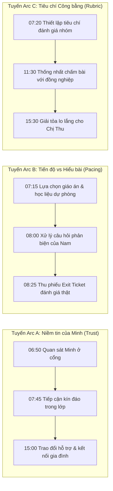

# STORY BIBLE — JOBSIMU 3D: NGƯỜI THẦY SAU TIẾNG TRỐNG TRƯỜNG

> **Dự án:** JOBSIMU 3D (Vertical Slice — Ngày 1 Nghề Giáo Viên THCS)  
> **Source of Truth:** [`docs/game3d.md`](file:///home/minhphuc/jobsimu/docs/game3d.md)  
> **Phiên bản:** 1.0 — 07/11/2026

---

## 1. BỐI CẢNH & KHÔNG GIAN HỌC ĐƯỜNG

- **Tên trường:** Trường THCS Tuệ Đức (Mô hình trường phổ thông công lập tiêu biểu tại Việt Nam).
- **Quy mô phân vùng Vertical Slice (P0):**
  1. **Lớp 9A (Class9A):** Phòng học tầng 2, 4 dãy bàn học sinh đôi, bục giảng, bảng đen 2 cánh, máy chiếu treo trần, quạt trần, cửa sổ nhìn ra sân trường.
  2. **Phòng Hội đồng / Giáo viên (StaffRoom):** Tầng 1, các cụm bàn làm việc theo tổ chuyên môn, máy in/photo học liệu, tủ đựng hồ sơ, bàn của Cô Mai (Tổ trưởng/Mentor).
  3. **Hành lang & Cầu thang (Corridor):** Nối giữa sảnh tầng 1 và lớp học tầng 2, bảng thông báo Đoàn/Đội, lan can ngắm sân trường.
  4. **Sân trường & Cổng trường (Yard):** Cột cờ trung tâm, hàng cây bóng mát (phượng, bàng), ghế đá, cổng bảo vệ.

---

## 2. HỒ SƠ 10 NHÂN VẬT CHỦ CHỐT (CORE NPCS)

### 2.1. Nhân vật Người chơi (Player)
- **Tên:** Thầy/Cô An (Giáo viên môn Khoa học tự nhiên / Sinh học - Địa lý phụ trách chủ đề Biến đổi khí hậu).
- **Vị thế:** Giáo viên trẻ mới về trường, nhiệt huyết nhưng đứng trước nhiều tình huống thực tế không có trong sách giáo trình.

### 2.2. Đội ngũ Giáo viên & Cán bộ Nhà trường
1. **Cô Mai (Tổ trưởng Chuyên môn & Người Hướng dẫn / Mentor):**
   - *Tính cách:* Dày dặn kinh nghiệm, chu đáo, ấm áp nhưng nghiêm túc về quy chuẩn giảng dạy.
   - *Lịch trình:* 07:00–07:25 tại Phòng GV; 11:30–12:30 tại Phòng GV; 15:30–16:30 sinh hoạt chuyên môn.
   - *Vai trò:* Cung cấp thông tin cảnh báo sớm về thiết bị máy chiếu, tư vấn khi người chơi gặp bối rối.
2. **Cô Hạnh (Hiệu phó Chuyên môn / Giáo viên Chủ nhiệm):**
   - *Tính cách:* Quyết đoán, coi trọng kỷ luật và tiến độ kế hoạch năm học.
   - *Vai trò:* Nhắc nhở về tiến độ chương trình (`ARC-B`), quan sát giờ thao giảng hoặc kiểm tra đột xuất.
3. **Thầy Quân (Giáo viên Tin học & Phụ trách Thiết bị):**
   - *Tính cách:* Nhiệt tình nhưng luôn quá tải công việc sửa chữa khắp trường.
   - *Vai trò:* Hỗ trợ kỹ thuật máy chiếu (`PREP-01`, `MOVE-01`). Đánh đổi: nếu người chơi giúp thầy một việc nhỏ, thầy sẽ ưu tiên kiểm tra máy chiếu lớp 9A sớm.
4. **Cô Lan (Cán bộ Y tế & Tư vấn Tâm lý Học đường):**
   - *Tính cách:* Bình tĩnh, thấu hiểu, tuân thủ đạo đức nghề nghiệp và quy tắc bảo mật an toàn.
   - *Vai trò then chốt:* Điểm tiếp nhận chuyển tuyến duy nhất khi người chơi phát hiện nguy cơ bắt nạt hoặc an toàn học sinh (`CRISIS-03`).

### 2.3. Học sinh Lớp 9A
5. **Minh (Học sinh Trọng tâm — Tuyến Arc A):**
   - *Đặc điểm:* Trầm lặng, hay nhìn ra cửa sổ hoặc vẽ nguệch ngoạc vào vở, lực học sa sút gần đây.
   - *Bản chất sự việc:* Không phải ngỗ ngược hay mắc bệnh tâm lý; gia đình đang gặp khó khăn, mẹ (Chị Thu) đi làm ca đêm, Minh phải phụ việc gia đình và thiếu ngủ, nhưng có năng khiếu quan sát và hình ảnh rất tốt.
   - *Cờ quan hệ:* `minh_observed`, `minh_trust`, `minh_drawing_discovered`.
6. **Linh (Lớp trưởng Lớp 9A):**
   - *Đặc điểm:* Nhanh nhẹn, gương mẫu, trách nhiệm cao, hơi cứng nhắc với bạn bè.
   - *Vai trò:* Cầu nối thông tin lớp, hỗ trợ giáo viên phát phiếu kiểm tra và ổn định trật tự.
7. **Nam (Học sinh Tư duy Phản biện & Năng nổ):**
   - *Đặc điểm:* Thông minh, thích đọc sách, thường đặt câu hỏi hóc búa thách thức bài giảng (`CLASS-02`).
   - *Tình huống:* Hỏi câu hỏi nằm ngoài slide về số liệu biến đổi khí hậu thực tế tại địa phương.
8. **Hà (Học sinh Hướng nội, Năng khiếu Mỹ thuật):**
   - *Đặc điểm:* Ngồi gần Minh, quan sát bạn bè tinh tế, nhút nhát khi phát biểu trước lớp.
9. **Tuấn (Học sinh Hiếu động, Tinh nghịch):**
   - *Đặc điểm:* Hay nói chuyện riêng, chọc ghẹo bạn bè nếu bài học rơi vào khoảng lặng nhàm chán.

### 2.4. Phụ huynh
10. **Chị Thu (Mẹ của học sinh Minh — Tuyến Arc C):**
    - *Đặc điểm:* Công nhân lao động vất vả, thương con nhưng tự ti và lo lắng khi bị mời đến trường.
    - *Tình huống:* Buổi gặp gỡ 15:00 tại Phòng Tư vấn. Nếu giáo viên dùng ngôn từ phán xét, chị sẽ co cụm phòng thủ; nếu giáo viên chia sẻ trên tinh thần thấu hiểu và ghi nhận điểm mạnh của Minh, chị sẽ mở lòng hợp tác.

---

## 3. BA CHUỖI CỐT TRUYỆN LIÊN KẾT (3 INTERCONNECTED ARCS)

---

## 4. QUY CHUẨN SƯ PHẠM & AN TOÀN HỌC ĐƯỜNG BẤT BIẾN

1. **Tuyệt đối cấm sỉ nhục trước lớp:** Hành vi quát mắng, bắt học sinh đứng góc lớp hoặc bêu tên trước tập thể lập tức bị ghi nhận là hành vi tiêu cực sư phạm trong báo cáo hướng nghiệp.
2. **Không tự suy đoán bệnh lý:** Giáo viên không được tự gán nhãn y khoa (ADHD, trầm cảm, tự kỷ...) cho học sinh. Mọi khó khăn chỉ được mô tả bằng biểu hiện hành vi quan sát được.
3. **Quy trình An toàn Học sinh (`CRISIS-03`):**
   - **Bước 1:** Lắng nghe ở không gian riêng tư, đảm bảo học sinh cảm thấy an toàn.
   - **Bước 2:** Không hứa giữ bí mật tuyệt đối nếu liên quan đến nguy cơ tổn hại thể chất/tâm lý.
   - **Bước 3:** Chuyển tuyến ngay lập tức cho Cô Lan (Y tế/Tư vấn) hoặc BGH để giải quyết theo quy trình chuyên môn.
