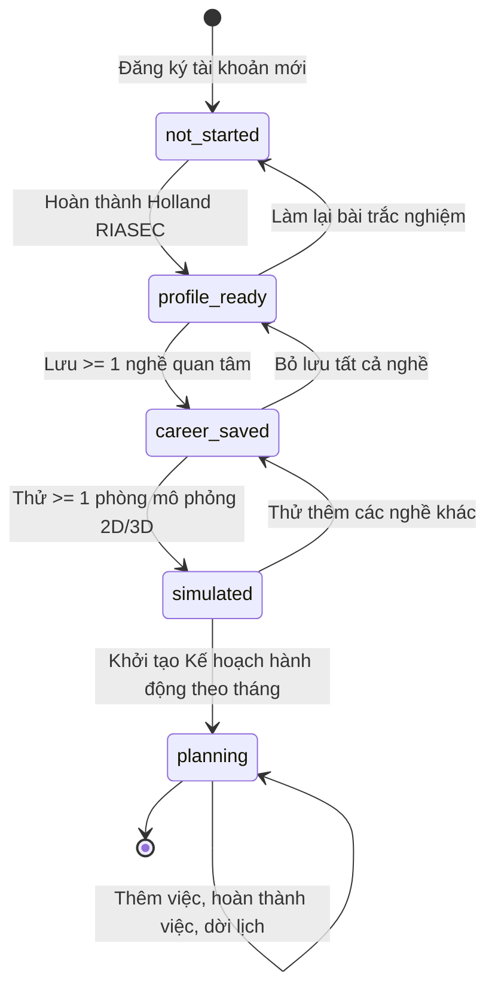

# Kiến Trúc Thông Tin & Trạng Thái Hành Trình Học Sinh (User Journey Architecture)
*Cập nhật: Tháng 11/2026 — Antigravity Engineering Lead*

---

## 1. NGUYÊN TẮC THIẾT KẾ HÀNH TRÌNH

1. **Chu trình linh hoạt, không tuyến tính cứng nhắc**:
   - Học sinh không bị ép buộc phải "chọn được nghề" ngay lập tức để hoàn thành.
   - Luôn cho phép: quay lại bước trước, thay đổi nghề quan tâm, tạm dừng, lưu việc làm dở dang và tiếp tục vào lúc khác.
2. **Không chặn tra cứu công khai**:
   - Học sinh chưa làm trắc nghiệm vẫn được tự do tra cứu thông tin trường, ngành đào tạo và điểm chuẩn công khai.
3. **Một nguồn quyết định Bước tiếp theo duy nhất (Single Source of Truth for Next Step)**:
   - Dashboard, Chatbot Trợ lý La Bàn và trang Kết quả cùng dùng chung một bộ resolver: `journey_resolve_next_step($userId)`.
   - Loại bỏ hoàn toàn tình trạng Dashboard gợi ý một đằng, Chatbot khuyên một nẻo.

---

## 2. MA TRẬN TRẠNG THÁI HỌC SINH (JOURNEY STATES)

| Trạng thái (`state_code`) | Điều kiện dữ liệu | Mục tiêu của học sinh | Bước hành động ưu tiên (`journey_next_step`) |
| :--- | :--- | :--- | :--- |
| `not_started` | Chưa có bản ghi trong `assessments` | Tìm hiểu sở thích và thiên hướng ban đầu | Làm bài khảo sát sở thích Holland (O*NET 30 câu, 5-7 phút) $\rightarrow$ `index.php?page=assessment` |
| `profile_ready` | Đã có mã Holland, `favorites` = 0 | Đối chiếu mã sở thích với thực tế | Xem danh sách nghề tương đồng và bấm "♡ Lưu nghề" $\rightarrow$ `index.php?page=result&id=...` |
| `career_saved` | Đã lưu $\ge 1$ nghề, `sim_count` = 0 | Kiểm chứng sự phù hợp qua tình huống thật | Thử thách tại Phòng mô phỏng nghề (2D SJT, 4-6 phút) $\rightarrow$ `index.php?page=simulations` |
| `simulated` | Đã thử mô phỏng, `user_roadmaps` chưa có task | Định hình lộ trình cho năm học | Lập kế hoạch hành động theo tháng $\rightarrow$ `index.php?page=ai-roadmap` |
| `planning` | Đã có mục tiêu và danh sách task trong tháng | Rèn luyện và chuẩn bị hồ sơ từng bước | Thực hiện công việc trọng tâm của tháng hiện tại $\rightarrow$ `index.php?page=ai-roadmap` |

---

## 3. CẤU TRÚC ĐIỀU HƯỚNG BỐN NHÓM CHÍNH (NAVIGATION SITEMAP)

| Nhóm điều hướng | Route chính | Mô tả chức năng & Đối tượng phục vụ |
| :--- | :--- | :--- |
| **1. Hành trình của em** | `?page=dashboard` | Không gian cá nhân: bước tiếp theo, nghề đã lưu, tiến độ 4 trụ cột, cài đặt hồ sơ. |
| **2. Khám phá** | `?page=knowledge-hub` `?page=majors` `?page=lookup` `?page=university-explorer` | Tri thức nghề nghiệp O*NET, danh mục 358 mã ngành đào tạo cấp IV, tra cứu điểm chuẩn và học phí có nguồn. |
| **3. Thử nghề** | `?page=simulations` `?page=simulation-3d` | Phòng mô phỏng tình huống 2D có Trade-off và Evidence Drawer; cổng trải nghiệm 3D WebGL/Unity. |
| **4. Kế hoạch của em** | `?page=ai-roadmap` `?page=plan` | Bản đồ hành trình và lịch trình công việc theo tháng kèm Trợ lý La Bàn AI đồng hành. |

---

## 4. BẢO TOÀN ROUTE & TƯƠNG THÍCH NGƯỢC

1. Các route cũ như `?page=careers`, `?page=simulation-result`, `?page=test-big5`, `?page=test-caas`, `?page=soka-mirror` tiếp tục hoạt động 100% không bị xóa hay đổi tên.
2. Tuyệt đối không redirect các request POST làm mất dữ liệu form của người dùng.
3. Không làm đứt các liên kết Action ID được Trợ lý La Bàn cung cấp trong các phiên trò chuyện trước đó.
